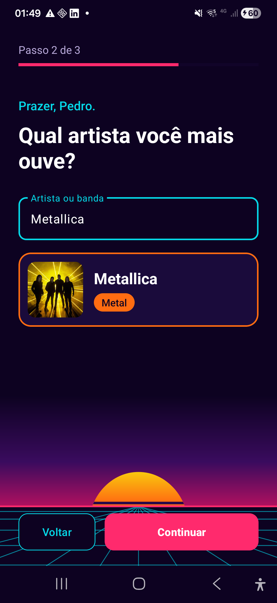
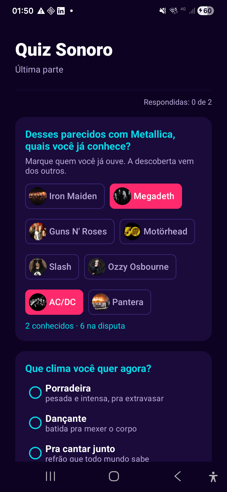
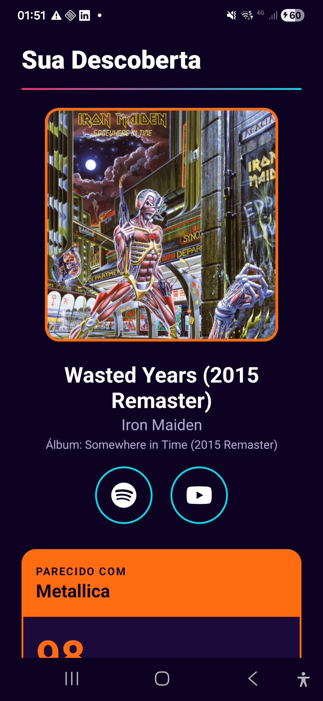
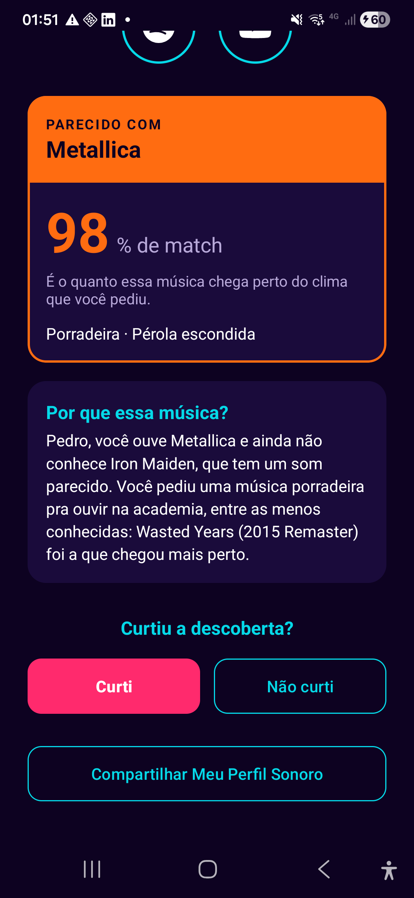
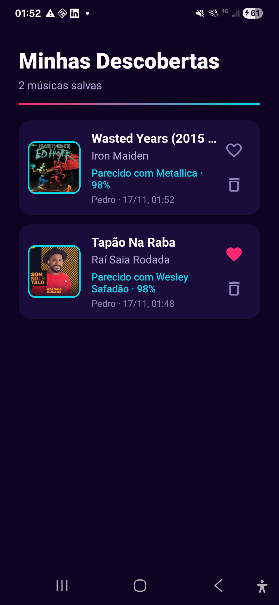

# SoundMatch – Descoberta Musical por Perfil Sonoro

Aplicativo Android nativo (Kotlin + XML Views) integrado a uma **API REST em FastAPI** com **banco de dados relacional SQLite**.

A ideia é recomendar **uma música nova, de um artista parecido com o que a pessoa já ouve e no clima que ela pediu**. Funciona assim:
- A pessoa conta o nome, o artista que mais ouve e quando mais ouve música.
- O app busca o artista no Deezer e traz os **artistas parecidos** com ele.
- No quiz, a pessoa marca quais desses parecidos já conhece (a descoberta vem dos outros), escolhe o **clima** que quer agora (Porradeira, Dançante, Pra cantar junto, Sofrência, Viajada ou De boa) e se prefere um **hit do momento** ou uma **pérola escondida**.
- O app pega as músicas mais tocadas dos parecidos que ela não conhece, consulta as características do som de cada uma (energia, alegria, o quanto é dançante e acústica) e escolhe a que chega mais perto do clima pedido.
- Com o **Quero me arriscar** ligado, a busca vai um passo além: os parecidos dos parecidos.
- O app mostra:
  - a **música recomendada**, com a capa do álbum;
  - o **% de match**, que é o quanto a música chega perto do clima pedido;
  - uma explicação do porquê da escolha.

Quem coloca Wesley Safadão e pede uma música dançante recebe um forró dançante de um artista que ainda não conhece. Quem coloca Metallica e pede uma porradeira recebe um metal pesado.

A pessoa responde "Curti" ou "Não curti", e a descoberta é salva no banco pela API. Em "Minhas Descobertas" dá para consultar, mudar a avaliação ou excluir.

**API publicada no Render:** https://soundmatch-api-dnh5.onrender.com · **Swagger:** [https://soundmatch-api-dnh5.onrender.com/docs](https://soundmatch-api-dnh5.onrender.com/docs)

> Projeto da **Avaliação Parcial 2 (AP2) – Desenvolvimento Mobile**.

---

## Screenshots

Prints tirados no celular físico (Galaxy S23 FE).

| Início | Perfil (passo 2 de 3) | Quiz |
|---|---|---|
|  |  |  |

| Resultado | Resultado (detalhes) | Minhas Descobertas |
|---|---|---|
|  |  |  |

---

## Telas e fluxo

```
MainActivity ──► UserProfileActivity ──► SoundQuizActivity ──► ResultActivity ──► (POST na API)
     │              (busca o artista        (busca as músicas       ├─► YouTube / Spotify (Intent implícita)
     │               e os parecidos)         e as características)  └─► Compartilhar (Intent implícita)
     └──────────────► HistoryActivity (GET / PUT / DELETE)
```

| # | Activity | O que faz | Views principais |
|---|---|---|---|
| 1 | `MainActivity` | Tela inicial: o disco de vinil nasce no horizonte e gira, e o título neon pulsa | ImageView, TextView, Button |
| 2 | `UserProfileActivity` | Perfil em formato de conversa, uma pergunta por vez, em 3 passos: nome, artista favorito (buscado no Deezer e mostrado num card com foto e estilo) e quando mais ouve música. Uma frase usa a resposta anterior ("Prazer, Pedro."), e no rodapé o sol sobe a cada passo. Tem "Passo X de 3", barra de progresso e Voltar / Continuar | EditText, Button, CheckBox (Chip), CardView, ImageView, ProgressBar |
| 3 | `SoundQuizActivity` | "Desses parecidos com Metallica, quais você já conhece?" (um chip com foto para cada artista), o clima da música, hit ou pérola e o Switch "Quero me arriscar". Ao pedir o resultado, busca as músicas candidatas e mostra uma barra de progresso | RadioButton, CheckBox (Chip), Switch, CardView, ProgressBar |
| 4 | `ResultActivity` | Estilo "tocando agora": capa do álbum, música, card "Parecido com Metallica" com o % de match e explicação. Curti / Não curti salva na API; abre no Spotify ou no YouTube e compartilha | ImageView, CardView, ProgressBar, Button |
| 5 | `HistoryActivity` | Lista de músicas salvas, cada uma com a capa. O coração muda a avaliação (PUT) e a lixeira exclui, com confirmação em AlertDialog (DELETE) | RecyclerView, CardView, ProgressBar |

**10 tipos de Views usados** (o edital exige 6): TextView, EditText, Button, ImageView, CheckBox (e Chip, que é um CheckBox), RadioButton, Switch, RecyclerView, ProgressBar e CardView.

---

## Tecnologias

| Camada | Tecnologias |
|---|---|
| **Android** | Kotlin, XML Views + ViewBinding, Material Components, RecyclerView, CardView, Retrofit 2 + Gson, Coroutines (`lifecycleScope`) |
| **Backend** | Python 3, FastAPI, SQLAlchemy 2.0, Pydantic 2, Uvicorn, publicado no Render |
| **Banco** | SQLite (relacional, com chave estrangeira) |
| **Documentação da API** | Swagger / OpenAPI, gerado automaticamente pelo FastAPI |
| **APIs externas** | Deezer (artistas parecidos e músicas mais tocadas), ReccoBeats (características do som) e iTunes Search (estilo do artista e reserva) |
| **Testes** | JUnit 4 (regra de negócio do app) |

**Build Android:** AGP 8.7.3, Kotlin 2.0.21, Gradle 8.9, Java 17, `compileSdk`/`targetSdk` 35, `minSdk` 24.

**Identidade visual:** "Neon Miami / synthwave anos 80".
- Tema escuro, com magenta `#FF2A6D` e ciano `#05D9E8`.
- Fonte retrô **Monoton** (licença OFL) no título da tela inicial; nas outras telas, títulos limpos com uma linha em degradê magenta → ciano.
- Sol listrado, grade e disco de vinil desenhados em Vector Drawable.
- Cada estilo tem a sua cor: pop magenta, rock laranja, hip-hop amarelo, eletrônica ciano e brasileira verde. O card do artista e o do resultado usam a cor do estilo do artista favorito.

---

## Estrutura do projeto

```
SoundMatch/
├── backend/                     API REST (FastAPI + SQLite)
│   ├── main.py                  endpoints CRUD
│   ├── models.py                tabelas (users 1:N recommendations)
│   ├── schemas.py               formato e validação do JSON
│   ├── database.py              conexão com o SQLite
│   └── requirements.txt
└── android/app/src/main/java/com/example/soundmatch/
    ├── ui/                      as 5 Activities
    ├── adapter/                 HistoryAdapter (RecyclerView)
    ├── network/                 Retrofit (SoundMatchApi, DeezerApi, ReccoBeatsApi, ITunesApi), DiscoveryRepository e ImageLoader
    ├── model/                   dados (UserProfile, QuizAnswers, SoundResult, Energy, Popularity, respostas das APIs)
    └── logic/                   regra de negócio (DiscoveryEngine, DiscoveryRules, SoundMatchEngine, SongCatalog)
```

---

## Como executar

### 1. Backend (API)

A API já está publicada no Render (https://soundmatch-api-dnh5.onrender.com), e o app usa esse endereço. No plano grátis, ela "dorme" depois de 15 minutos sem uso. A primeira chamada pode levar até 1 minuto, enquanto ela acorda (abrir o `/docs` antes resolve), e o SQLite volta vazio sempre que ela reinicia.

Para rodar localmente:

```bash
cd backend
python -m venv .venv
source .venv/bin/activate            # Windows: .venv\Scripts\activate
pip install -r requirements.txt
uvicorn main:app --host 0.0.0.0 --port 8000 --reload
```

- **Swagger:** http://localhost:8000/docs
- O banco `soundmatch.db` é criado automaticamente na primeira execução.

### 2. App Android

1. Abra a pasta **`android/`** no Android Studio e aguarde o *Gradle Sync* (Gradle JDK: **17**).
2. Ligue o celular por USB, com a **Depuração USB** ativada. O app já aponta para a API no Render (`BASE_URL` em `network/RetrofitClient.kt`).
   Para usar a API local:
   - troque o `BASE_URL` para `http://localhost:8000/` e rode `adb reverse tcp:8000 tcp:8000`;
   - no emulador, use `http://10.0.2.2:8000/`.
3. Execute o app (Run). A busca do artista e das músicas precisa de internet no celular. Sem internet, o app segue só com o nome digitado e recomenda pelo catálogo fixo (ver "Reserva" abaixo).

**Testes da regra de negócio:** abra `app/src/test/.../logic/DiscoveryEngineTest.kt` e clique em Run. Pelo terminal, use `./gradlew test`.

---

## API REST

Base: `https://soundmatch-api-dnh5.onrender.com` (ou `http://localhost:8000` rodando localmente). Documentação interativa em **[https://soundmatch-api-dnh5.onrender.com/docs](https://soundmatch-api-dnh5.onrender.com/docs)** (Swagger UI).

| Método | Endpoint | Descrição | Usado em |
|---|---|---|---|
| `POST` | `/recommendations` | Cria o usuário, ou reaproveita um existente pelo nome, e salva a descoberta | ResultActivity (Curti / Não curti) |
| `GET` | `/recommendations` | Lista todas as descobertas com o usuário aninhado | HistoryActivity |
| `GET` | `/recommendations/{id}` | Busca uma descoberta | Swagger |
| `PUT` | `/recommendations/{id}` | Muda a avaliação (curti / não curti) | HistoryActivity |
| `DELETE` | `/recommendations/{id}` | Remove a descoberta (resposta 204) | HistoryActivity |

**Exemplo de `POST /recommendations`:**

```json
{
  "name": "Pedro",
  "favorite_artist": "Metallica",
  "listening_mode": "Academia",
  "plays_instrument": false,
  "score": 98,
  "archetype": "Parecido com Metallica",
  "recommended_song": "Wasted Years (2015 Remaster)",
  "song_artist": "Iron Maiden",
  "subgenres": "Porradeira · Pérola escondida",
  "liked": true,
  "surprise": false
}
```

A resposta traz o registro salvo, com `id`, `created_at` e o objeto `user` aninhado. O `score` (o % de match) é validado entre 10 e 100. Um valor fora dessa faixa retorna 422.

> Os nomes das colunas vêm da primeira versão do projeto:
> - `archetype` guarda o título do card do resultado (ex.: "Parecido com Metallica");
> - `score` guarda o % de match;
> - `subgenres` guarda a linha de detalhe do card (o clima e hit ou pérola);
> - `plays_instrument` ficou da época em que o perfil perguntava sobre instrumento e hoje vai sempre `false`.

### APIs externas

As três são públicas e não precisam de chave.

| API | Para que serve | Chamadas |
|---|---|---|
| [Deezer](https://developers.deezer.com/api) | Achar o artista, os parecidos e as músicas mais tocadas de cada um | `search/artist`, `artist/{id}/related`, `artist/{id}/top`, `track/{id}` |
| [ReccoBeats](https://reccobeats.com/docs) | Características do som de cada música: energia, alegria (`valence`), o quanto é dançante e acústica, de 0 a 1 | `v1/audio-features?ids=<ISRC,ISRC...>` |
| [iTunes Search](https://performance-partners.apple.com/search-api) | Estilo do artista (a cor do card) e capa das músicas do catálogo fixo | `search?term=<busca>&entity=song&country=BR` |

O Deezer identifica cada gravação por um código internacional, o ISRC, e é por ele que o app pede as características ao ReccoBeats.

### Banco de dados relacional

```
users (1) ────────< (N) recommendations
  id PK                   id PK
  name                    user_id FK → users.id
  favorite_artist         score (% de match), archetype (título do card)
  listening_mode          recommended_song, song_artist
  plays_instrument        subgenres (detalhe do card), liked, surprise
  created_at              created_at
```

---

## Lógica de recomendação

O código fica em `logic/DiscoveryEngine.kt`, sem nada de Android, e é coberto por testes unitários (37 no total, em `DiscoveryEngineTest`, `DiscoveryRulesTest`, `SoundMatchEngineTest` e `TrackPickerTest`). Em uma frase: **das músicas mais tocadas dos artistas parecidos que a pessoa não conhece, fica a metade pedida (hits ou pérolas) e ganha a que chega mais perto do clima.**

1. **Quem entra.** As 4 músicas mais tocadas de cada parecido que a pessoa não marcou como conhecido (até 8 artistas). O artista favorito e os conhecidos ficam de fora.
2. **Quero me arriscar.** Em vez dos parecidos, entram os parecidos deles (fora os que já eram parecidos diretos). O mesmo acontece se a pessoa marcar todos como conhecidos.
3. **Hit ou pérola.** As candidatas são ordenadas pela popularidade no Deezer e cortadas no meio: hit fica com a metade mais tocada, pérola com a outra.
4. **Clima.** Cada clima tem um alvo nos números do som, e ganha a música mais perto dele:

   | Clima | Alvo |
   |---|---|
   | Porradeira | energia 0,95 e som acústico 0,05 |
   | Dançante | dançante 0,85 e energia 0,8 |
   | Pra cantar junto | alegria 0,9 e energia 0,75 |
   | Sofrência | alegria 0,15 |
   | Viajada | dançante 0,3, energia 0,45 e música longa (6 minutos ou mais) |
   | De boa | energia 0,3 e alegria 0,6 |

5. **Situação.** Só desempata: na academia ganha a mais enérgica, na festa a mais dançante, estudando ou relaxando a mais calma.
6. **% de match** = 100 menos a distância média até o alvo. Exemplo: quem pede Sofrência entre artistas de forró recebe por volta de 60%, porque quase não há música triste ali, e o número mostra isso.
7. **Explicação.** Exemplo: "Pedro, você ouve Metallica e ainda não conhece Iron Maiden, que tem um som parecido. Você pediu uma música porradeira pra ouvir na academia, entre as menos conhecidas: Wasted Years (2015 Remaster) foi a que chegou mais perto."

### Reserva

Se o artista não for encontrado, se não houver internet ou se nenhuma música candidata tiver as características do som, entra o motor reserva (`logic/SoundMatchEngine.kt`):
- o estilo do artista (vindo do iTunes) vale 3 votos e cada estilo marcado em "outros estilos" vale 1; ganha o mais votado entre 5 estilos (Pop & K-pop, Rock & Alternativo, Hip-hop & R&B, Eletrônica e Música Brasileira);
- a música sai de um catálogo fixo (`logic/SongCatalog.kt`, 12 por estilo, 2 de cada clima), sem o artista favorito;
- o % de match é a parte dos votos que foi para o estilo vencedor.

---

## Requisitos do edital

| Requisito | Onde está |
|---|---|
| 5 Activities | `ui/` (Main, UserProfile, SoundQuiz, Result, History) |
| Intents explícitas | Main → Perfil / Histórico, Perfil → Quiz, Quiz → Resultado (com `putExtra`) |
| Intent implícita | `ResultActivity`: `ACTION_VIEW` (YouTube e Spotify) e `ACTION_SEND` (compartilhar) |
| 6+ Views | 10 tipos (lista acima) |
| API REST + Swagger | `backend/` + `/docs` |
| CRUD + JSON | POST, GET, PUT e DELETE via Retrofit (`network/SoundMatchApi.kt`) |
| Banco relacional | SQLite com `users` 1:N `recommendations` (FK) |
| Organização | Pacotes `ui`, `adapter`, `network`, `model`, `logic` |
| Bônus | App rodando em celular físico e API publicada em nuvem (Render) |
