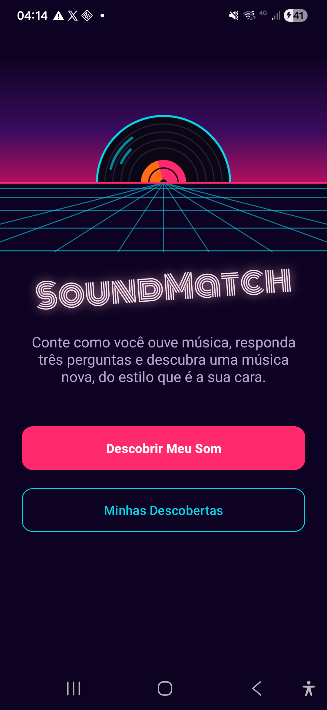

# SoundMatch – Descoberta Musical por Perfil Sonoro

Aplicativo Android nativo (Kotlin + XML Views) integrado a uma **API REST em FastAPI** com **banco de dados relacional SQLite**.

A ideia é recomendar **uma música nova, do estilo que é a cara da pessoa**. Funciona assim:
- A pessoa conta o nome, o artista que mais ouve, quando mais ouve música e se toca algum instrumento.
- O app busca o artista no iTunes para descobrir o gênero dele.
- A pessoa responde a um quiz curto.
- Cada resposta vira um voto em um de **5 perfis** (Pop & K-pop, Rock & Alternativo, Hip-hop & R&B, Eletrônica e Música Brasileira).
- O perfil mais votado ganha, e o app mostra:
  - o **% de match**, que é quanto das respostas apontou para esse perfil;
  - uma **música recomendada**, sempre de um artista diferente do favorito;
  - a capa do álbum;
  - uma explicação do porquê da escolha.

Quem coloca BTS, por exemplo, recebe uma descoberta do universo do pop e do K-pop, e não um rock aleatório.

A pessoa responde "Curti" ou "Não curti", e a descoberta é salva no banco pela API. Em "Minhas Descobertas" dá para consultar, mudar a avaliação ou excluir.

> Projeto da **Avaliação Parcial 2 (AP2) – Desenvolvimento Mobile**.

---

## Screenshots

Prints tirados no celular físico (Galaxy S23 FE).

| Início | Perfil (passo 2 de 4) | Quiz |
|---|---|---|
|  |  |  |

| Resultado | Resultado (detalhes) | Minhas Descobertas |
|---|---|---|
|  |  |  |

---

## Telas e fluxo

```
MainActivity ──► UserProfileActivity ──► SoundQuizActivity ──► ResultActivity ──► (POST na API)
     │              (busca o artista                                ├─► capa do álbum (iTunes)
     │               no iTunes)                                     ├─► YouTube / Spotify (Intent implícita)
     └──────────────► HistoryActivity (GET / PUT / DELETE)          └─► Compartilhar (Intent implícita)
```

| # | Activity | O que faz | Views principais |
|---|---|---|---|
| 1 | `MainActivity` | Tela inicial: o disco de vinil nasce no horizonte e gira, e o título neon pulsa | ImageView, TextView, Button |
| 2 | `UserProfileActivity` | Perfil em formato de conversa, uma pergunta por vez, em 4 passos: nome, artista favorito (buscado no iTunes e mostrado num card com capa e gênero), quando mais ouve música e instrumento. Tem "Passo X de 4", barra de progresso e Voltar / Continuar | EditText, Button, CheckBox (Chip), CardView, ImageView, ProgressBar |
| 3 | `SoundQuizActivity` | 3 perguntas com 5 opções cada, uma por perfil. A 1ª cita a situação escolhida e a 2ª cita o artista favorito. Depois vêm os "outros estilos que você curte". A barra avança a cada resposta | RadioButton, CheckBox, CardView, ProgressBar |
| 4 | `ResultActivity` | Estilo "tocando agora": capa do álbum, música, perfil com a cor do gênero, % de match e explicação. Curti / Não curti salva na API; abre no Spotify ou no YouTube e compartilha | ImageView, CardView, ProgressBar, Button |
| 5 | `HistoryActivity` | Lista as descobertas salvas, com a faixa na cor do perfil. Permite mudar a avaliação (PUT) e excluir, com confirmação em AlertDialog (DELETE) | RecyclerView, CardView, ProgressBar |

**9 tipos de Views usados** (o edital exige 6): TextView, EditText, Button, ImageView, CheckBox (e Chip, que é um CheckBox), RadioButton, RecyclerView, ProgressBar e CardView.

---

## Tecnologias

| Camada | Tecnologias |
|---|---|
| **Android** | Kotlin, XML Views + ViewBinding, Material Components, RecyclerView, CardView, Retrofit 2 + Gson, Coroutines (`lifecycleScope`) |
| **Backend** | Python 3, FastAPI, SQLAlchemy 2.0, Pydantic 2, Uvicorn |
| **Banco** | SQLite (relacional, com chave estrangeira) |
| **Documentação da API** | Swagger / OpenAPI, gerado automaticamente pelo FastAPI |
| **API externa** | iTunes Search API (gênero do artista e capa do álbum) |
| **Testes** | JUnit 4 (regra de negócio do app) |

**Build Android:** AGP 8.7.3, Kotlin 2.0.21, Gradle 8.9, Java 17, `compileSdk`/`targetSdk` 35, `minSdk` 24.

**Identidade visual:** "Neon Miami / synthwave anos 80".
- Tema escuro, com magenta `#FF2A6D` e ciano `#05D9E8`.
- Fonte retrô **Monoton** (licença OFL) nos títulos.
- Sol listrado, grade e disco de vinil desenhados em Vector Drawable.
- Cada perfil tem a sua cor: pop magenta, rock laranja, hip-hop amarelo, eletrônica ciano e brasileira verde.

---

## Estrutura do projeto

```
SoundMatch/
├── backend/                     API REST (FastAPI + SQLite)
│   ├── main.py                  endpoints CRUD
│   ├── models.py                tabelas (users 1:N recommendations)
│   ├── schemas.py               formato e validação do JSON
│   ├── database.py              conexão com o SQLite
│   └── requirements.txt
└── android/app/src/main/java/com/example/soundmatch/
    ├── ui/                      as 5 Activities
    ├── adapter/                 HistoryAdapter (RecyclerView)
    ├── network/                 Retrofit (SoundMatchApi, ITunesApi, RetrofitClient) e ImageLoader
    ├── model/                   dados (Genre, Instrument, Situation, UserProfile, SoundResult, JSON da API)
    └── logic/                   regra de negócio (SoundMatchEngine, SongCatalog, ArtistName)
```

---

## Como executar

### 1. Backend (API)

```bash
cd backend
python -m venv .venv
source .venv/bin/activate            # Windows: .venv\Scripts\activate
pip install -r requirements.txt
uvicorn main:app --host 0.0.0.0 --port 8000 --reload
```

- **Swagger:** http://localhost:8000/docs
- O banco `soundmatch.db` é criado automaticamente na primeira execução.

### 2. App Android

1. Abra a pasta **`android/`** no Android Studio e aguarde o *Gradle Sync* (Gradle JDK: **17**).
2. Ligue o celular por USB, com a **Depuração USB** ativada, e rode no PC:
   ```bash
   adb reverse tcp:8000 tcp:8000
   ```
   O app acessa a API em `http://localhost:8000/`, e o `adb reverse` leva essa porta do celular até o PC.
   No emulador, troque o `BASE_URL` em `network/RetrofitClient.kt` para `http://10.0.2.2:8000/`.
3. Execute o app (Run). A busca do artista e a capa do álbum precisam de internet no celular. Sem internet, o app segue só com o nome digitado e mostra um disco de vinil no lugar da capa.

**Testes da regra de negócio:** abra `app/src/test/.../logic/SoundMatchEngineTest.kt` e clique em Run. Pelo terminal, use `./gradlew test`.

---

## API REST

Base: `http://localhost:8000`. Documentação interativa em **[/docs](http://localhost:8000/docs)** (Swagger UI).

| Método | Endpoint | Descrição | Usado em |
|---|---|---|---|
| `POST` | `/recommendations` | Cria o usuário, ou reaproveita um existente pelo nome, e salva a descoberta | ResultActivity (Curti / Não curti) |
| `GET` | `/recommendations` | Lista todas as descobertas com o usuário aninhado | HistoryActivity |
| `GET` | `/recommendations/{id}` | Busca uma descoberta | Swagger |
| `PUT` | `/recommendations/{id}` | Muda a avaliação (curti / não curti) | HistoryActivity |
| `DELETE` | `/recommendations/{id}` | Remove a descoberta (resposta 204) | HistoryActivity |

**Exemplo de `POST /recommendations`:**

```json
{
  "name": "Pedro",
  "favorite_artist": "BTS",
  "listening_mode": "Academia",
  "plays_instrument": true,
  "score": 86,
  "archetype": "Pop & K-pop",
  "recommended_song": "Espresso",
  "song_artist": "Sabrina Carpenter",
  "subgenres": "Eletrônica",
  "liked": true
}
```

A resposta traz o registro salvo, com `id`, `created_at` e o objeto `user` aninhado. O `score` (o % de match) é validado entre 10 e 100. Um valor fora dessa faixa retorna 422.

> Os nomes das colunas vêm da primeira versão do projeto:
> - `archetype` guarda o perfil (ex.: "Pop & K-pop");
> - `score` guarda o % de match;
> - `subgenres` guarda os outros estilos marcados.

### API externa: iTunes Search

O app consulta a [iTunes Search API](https://performance-partners.apple.com/search-api), que é pública e não precisa de chave, em dois momentos:
- **no perfil**, para achar o artista favorito, o nome oficial e o gênero (ex.: BTS → "K-pop");
- **no resultado**, para buscar o álbum e a capa da música recomendada.

`GET https://itunes.apple.com/search?term=<busca>&entity=song&limit=1&country=BR`

A loja do Brasil (`country=BR`) acerta mais os gêneros brasileiros, como MPB, sertanejo e pagode.

### Banco de dados relacional

```
users (1) ────────< (N) recommendations
  id PK                   id PK
  name                    user_id FK → users.id
  favorite_artist         score (% de match), archetype (perfil)
  listening_mode          recommended_song, song_artist
  plays_instrument        subgenres (outros estilos), liked
  created_at              created_at
```

---

## Lógica de recomendação

O código fica em `logic/SoundMatchEngine.kt`, sem nada de Android, e é coberto por 12 testes unitários.

1. **Votos.** Cada resposta é um voto em um dos 5 perfis:
   - o gênero do artista favorito (vindo do iTunes) vale **3 votos**;
   - cada pergunta do quiz vale 1 voto (a opção N vota no perfil N);
   - cada estilo marcado em "outros estilos que você curte" vale 1 voto.
2. **Perfil.** Ganha o mais votado. Em caso de empate, ganha o gênero do artista favorito.
3. **% de match** = votos do perfil vencedor ÷ total de votos × 100, arredondado e limitado entre 10 e 100.
   Exemplo dos prints:
   - BTS (K-pop) dá 3 votos para Pop;
   - as 3 respostas do quiz dão mais 3 votos para Pop;
   - marcar "Eletrônica" dá 1 voto para Eletrônica;
   - Pop fica com 6 de 7 votos, ou seja, **86%**.
4. **Música.** O catálogo (`logic/SongCatalog.kt`) tem 5 músicas por perfil, 25 no total. Em cada perfil, cada música destaca um instrumento (voz, bateria, baixo, teclado e guitarra). O app:
   - **tira o artista favorito**, para ser sempre uma descoberta;
   - para quem toca, escolhe a música em que o seu instrumento se destaca;
   - para os outros, faz uma escolha fixa pelo nome da pessoa (a mesma pessoa sempre recebe a mesma música).
5. **Explicação.** Cita o nome, o artista favorito, o perfil e o artista da descoberta. Para quem toca, diz em que prestar atenção (ex.: "Você toca baixo: repare na linha de baixo de Espresso").

O gênero do iTunes vira um dos 5 perfis por palavras-chave (`Genre.fromITunes`). Alguns exemplos:
- "K-pop" → Pop;
- "Metal" → Rock;
- "Hip-Hop/Rap" → Hip-hop;
- "Dance" → Eletrônica;
- "Sertanejo" → Brasileira.

Se o artista não for encontrado, ou não houver internet, o perfil sai só das respostas do quiz.

---

## Requisitos do edital

| Requisito | Onde está |
|---|---|
| 5 Activities | `ui/` (Main, UserProfile, SoundQuiz, Result, History) |
| Intents explícitas | Main → Perfil / Histórico, Perfil → Quiz, Quiz → Resultado (com `putExtra`) |
| Intent implícita | `ResultActivity`: `ACTION_VIEW` (YouTube e Spotify) e `ACTION_SEND` (compartilhar) |
| 6+ Views | 9 tipos (lista acima) |
| API REST + Swagger | `backend/` + `/docs` |
| CRUD + JSON | POST, GET, PUT e DELETE via Retrofit (`network/SoundMatchApi.kt`) |
| Banco relacional | SQLite com `users` 1:N `recommendations` (FK) |
| Organização | Pacotes `ui`, `adapter`, `network`, `model`, `logic` |
| Bônus | App rodando em celular físico (`adb reverse tcp:8000 tcp:8000`) |
